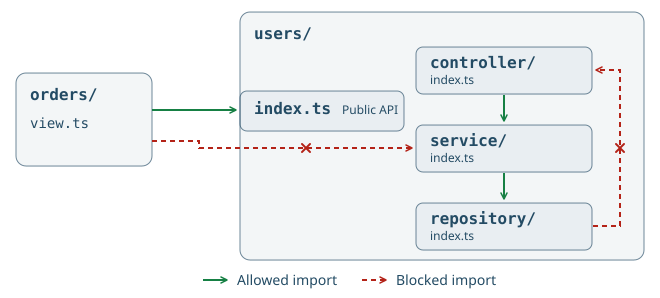

# Boundary

<p align="center">
  
</p>

**Declarative, filesystem-based architecture enforcement for JavaScript and TypeScript. Powered by ESLint and Oxlint.**

- **Convention over configuration.** A folder with an `index.ts` or `index.js` becomes a module. Its index defines the public API.
- **Architecture as code.** Declare dependency rules and layers in [`.boundary.ts`](#module-policies) and enforce them during linting.
- **Local configuration.** Keep each module's architectural policy next to its implementation.
- **Nested modules.** Define public APIs and dependency policies at different levels of the directory tree.
- **AI guardrails.** Catch architecture violations in agent-generated code with the same lint checks you run in CI.
- **Linter agnostic.** Share policy files across lint setups.

## How it works

- **Dependency policies** define which dependencies are allowed. A [`.boundary.*` file](#module-policies) can govern a directory and its descendants even if the directory has no `index.*`.
- **Public API rules** define where imports can enter a module. Code outside a module imports it through its public `index.*` instead of reaching into its implementation.

Enable either independently, or use the [recommended preset](#recommended-preset) for both.

<p align="center">
  
</p>

```text
src/
├── orders/
│   ├── index.ts
│   └── view.ts
└── users/
    ├── .boundary.ts
    ├── index.ts
    ├── controller/
    │   ├── index.ts
    │   └── route.ts
    ├── repository/
    │   ├── index.ts
    │   └── read-user.ts
    └── service/
        ├── index.ts
        └── get-user.ts
```

```ts
// src/users/.boundary.ts
import { defineBoundary } from '@b12k/boundary';

export default defineBoundary({ layers: ['repository', 'service', 'controller'] });
```

## Quick start

Install [@b12k/boundary](https://www.npmjs.com/package/@b12k/boundary) with your package manager:

```sh
npm install -D @b12k/boundary
pnpm add -D @b12k/boundary
yarn add -D @b12k/boundary
bun add -d @b12k/boundary
```

Requires Node.js 24+ and either ESLint 9 or 10, or Oxlint 1.x (1.58 or later).

### ESLint

Add the preset to your flat config:

```js
import boundary from '@b12k/boundary';

export default [{ ...boundary.configs.recommended, files: ['**/*.{ts,js,mjs,cjs,tsx,jsx}'] }];
```

Keep your project's parser configuration for TypeScript and JSX.

### Oxlint

Extend the preset in `oxlint.config.ts`:

```ts
import { oxlintRecommended } from '@b12k/boundary';
import { defineConfig } from 'oxlint';

export default defineConfig({ extends: [oxlintRecommended] });
```

For `.oxlintrc.json`, register `{"name": "boundary", "specifier": "@b12k/boundary"}` in `jsPlugins` and copy the `rules` block below to use the same defaults.

## Recommended preset

Both presets register the plugin as `boundary`. The module and index checks work without policy files, so you can start by linting one area and add `.boundary.ts` where you need dependency constraints.

See the [rule reference](#rules) for what each rule checks. The JSON includes the default `allowFromBarrels` option:

```json
{
  "rules": {
    "boundary/barrel-reexports-only": "error",
    "boundary/no-deep-imports": "error",
    "boundary/no-empty-module": "error",
    "boundary/no-explicit-index": "error",
    "boundary/no-export-star": ["error", { "allowFromBarrels": true }],
    "boundary/no-internal-barrel-imports": "error",
    "boundary/no-parent-reexports": "error",
    "boundary/no-shadowed-module-entry": "error",
    "boundary/no-useless-barrel": "error",
    "boundary/use-dot-boundary": "error"
  }
}
```

`boundary/require-dot-boundary` is opt-in. To require a policy file in every module, add the rule in a later ESLint flat-config entry or in the Oxlint config's top-level `rules`:

```json
{ "rules": { "boundary/require-dot-boundary": "error" } }
```

## Comparison with JS Boundaries

|                     | `@b12k/boundary`                                              | [JS Boundaries (`eslint-plugin-boundaries`)](https://www.jsboundaries.dev/docs/overview/)         |
| ------------------- | ------------------------------------------------------------- | ------------------------------------------------------------------------------------------------- |
| Module discovery    | Directories with an `index` file                              | Configurable patterns for elements and files                                                      |
| Policy location     | `.boundary.*` in any project directory                        | Classification and dependency policies in the linter config                                       |
| Public entry points | The module's `index` by convention                            | Configurable entry-point paths through dependency selectors                                       |
| Dependency rules    | Import allow/deny lists, ordered layers, and sibling policies | Selectors for elements, files, and dependency metadata                                            |
| Barrel rules        | Dedicated rules for writing and importing index files         | No dedicated barrel-organization rules                                                            |
| Linters             | ESLint and Oxlint presets                                     | ESLint and [Oxlint via `jsPlugins`](https://www.jsboundaries.dev/docs/guides/oxlint-integration/) |

## Module policies

Place one `.boundary.{ts,js,mjs,cjs,tsx,jsx}` file in any project directory, with or without an `index.*`. Its policies apply to that directory and its descendants.

```ts
// users/.boundary.ts
import { defineBoundary } from '@b12k/boundary';

export default defineBoundary({
  imports: { allow: ['../shared', '../config/locale.ts'] },
  layers: ['repository', ['service', 'events.ts'], 'controller'],
  hierarchy: { controller: ['service'] },
});
```

- **`imports`** controls local project dependencies outside the config's directory tree. `allow` permits only the listed files and folders; `deny` blocks only those listed. A folder covers all its descendants. Use paths relative to the config or `tsconfig.json` aliases.
- **`layers`** orders children from lowest to highest. A child can import from lower layers. Children on the same layer cannot import each other.
- **`hierarchy`** lists which siblings a child can import. Use an empty list to block all sibling imports or omit the child to leave its sibling imports unrestricted by `hierarchy`.

`layers` and `hierarchy` use direct child names, including file extensions. A folder entry covers all its descendants, even without an `index.*`.

Dependencies must satisfy every applicable policy and the public entry-point rules.

For CommonJS, use `const { defineBoundary } = require('@b12k/boundary')` and `module.exports = defineBoundary({ … })`. The linter reads the object literal statically.

### Denylist alternative

Use `deny` in place of `allow` to block a folder and a specific file:

```ts
// users/.boundary.ts
import { defineBoundary } from '@b12k/boundary';

export default defineBoundary({ imports: { deny: ['../legacy', '../config/experimental.ts'] } });
```

## Rules

Prefix the rule names below with `boundary/` in your linter config.

| Rule                         | Behavior                                                                                                                                |
| ---------------------------- | --------------------------------------------------------------------------------------------------------------------------------------- |
| `barrel-reexports-only`      | Allows direct re-exports in an index, including named type re-exports.                                                                  |
| `no-deep-imports`            | Requires imports entering another module to use the first public index they cross.                                                      |
| `no-empty-module`            | Reports a module directory that contains only its index files and optional `.boundary.*` config.                                        |
| `no-explicit-index`          | Removes `/index` when directory imports are supported and both specifiers resolve to the same index.                                    |
| `no-export-star`             | Limits wildcard re-exports (`export *` and `export * as name`) in an index to another module's public index by default.                 |
| `no-internal-barrel-imports` | Forbids importing your own index or an ancestor's index.                                                                                |
| `no-parent-reexports`        | Keeps an index's local re-exports inside its directory.                                                                                 |
| `no-shadowed-module-entry`   | Reports a module's index when a same-name sibling file can shadow the directory import.                                                 |
| `no-useless-barrel`          | Reports an index that only re-exports a lone implementation file named after its directory. Tests and styles count as supporting files. |
| `require-dot-boundary`       | Reports a module's index when its directory has no `.boundary.*` file of its own.                                                       |
| `use-dot-boundary`           | Validates `.boundary.*` files and reports forbidden dependencies at the import or re-export.                                            |

For CommonJS files, Boundary checks literal `require()` calls and direct re-exports such as `module.exports = require('./child/index.cjs')` and `exports.read = require('./reader.cjs').read`.

### `no-export-star`

Set `allowFromBarrels` to `false` to disallow wildcard re-exports even between module indices.

```json
{ "rules": { "boundary/no-export-star": ["error", { "allowFromBarrels": false }] } }
```
